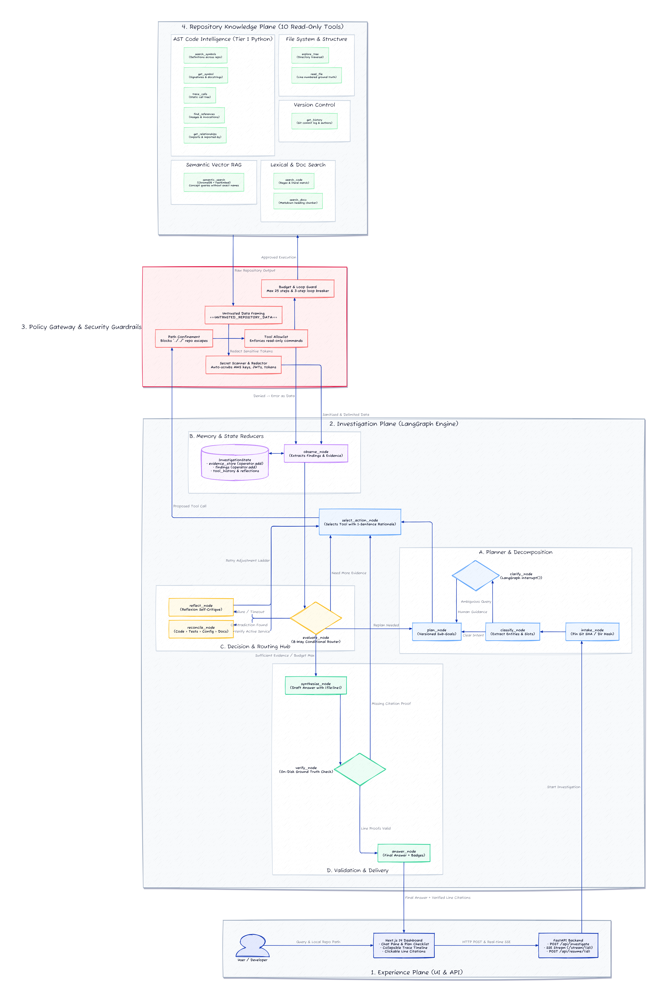

# RepoMind: Autonomous Local Repository Investigation Agent

> An autonomous, read-only software repository investigation agent built with **LangGraph**, **Google Gemini / Groq**, **ChromaDB**, **FastAPI**, and **Next.js**.

[](tests/unit/)
[](tests/integration/)
[-blue)](evaluation_report.pdf)
[-slate)](pyproject.toml)

---

## 1. Overview & Core Principles

RepoMind investigates local software repositories to answer architectural, flow-tracing, error-origin, and symbol-definition questions with verifiable line citations.

### Core Principles
1. **Local and Read-Only by Construction**: Operates strictly inside target repository directories. No code execution, git commits, or file mutations are permitted.
2. **Snapshot Identity is Immutable**: Each investigation is pinned to a commit SHA (`git rev-parse HEAD`) or directory content hash.
3. **The Index is an Accelerator; the Snapshot is Truth**: Vector chunks and AST indices accelerate lookup, but every factual assertion in the final answer is verified against real file lines on disk.
4. **The Model Proposes; the Application Disposes**: All tool proposals pass through a `PolicyGateway` enforcing path traversal prevention (`../../`), tool allowlists, and step budgets.
5. **Prompt Injection Defense & Secret Redaction**: Repository data is encapsulated in explicit system demarcation frames (`<<<UNTRUSTED_REPOSITORY_DATA>>>`) and credentials (`AKIA...`, private keys, passwords) are automatically redacted.

---

## 2. Agent Pattern & Workflow

RepoMind employs a **Hybrid Agent Architecture** combining **Plan-and-Solve**, **ReAct (Reason + Act)**, and **Reflexion (Self-Critique)**.

### The Agentic Workflow
1. **Intake & Snapshot Pinning (`intake_node`)**: Resolves local Git SHA or directory hash, initializes state budgets and capabilities.
2. **Classification & Slot Formulation (`classify_node`)**: Classifies the query (e.g. `TRACE_FLOW`, `LOCATE`, `ARCHITECTURE`), extracts entities, and defines required evidence slots.
3. **Human-in-the-Loop Clarification (`clarify_node`)**: If an ambiguous query lacks search context, triggers LangGraph's `interrupt()` to stream an interactive question to the user.
4. **Versioned Sub-Goal Planning (`plan_node`)**: Decomposes the task into an ordered checklist of sub-goals mapped to open evidence slots.
5. **Action Selection with Rationale (`select_action_node`)**: Chooses the next read-only tool with a mandatory 1-sentence rationale.
6. **Policy Gateway Interception (`policy_check_node`)**: Verifies path confinement, tool allowlist, and step budgets.
7. **Tool Execution & Framing (`execute_tool_node`)**: Dispatches the tool and wraps output inside `<<<UNTRUSTED_REPOSITORY_DATA>>>` with secret sanitization.
8. **Deterministic Observation (`observe_node`)**: Extracts structured `EvidenceItem` and `Finding` entries directly from tool outputs.
9. **Central Evaluation Routing (`evaluate_node`)**: 8-way conditional router assessing sufficiency, budget, loops, and failure conditions.
10. **Reflexion Diagnostic Loop (`reflect_node`)**: On tool error or empty results, critiques the failure and steps through the retry adjustment ladder.
11. **Authority Reconciliation (`reconcile_node`)**: Resolves documentation discrepancies using the strict hierarchy: **Code > Tests > Config > Documentation**.
12. **Answer Synthesis (`synthesize_node`)**: Drafts an answer grounded strictly in accumulated findings with inline `[file:line]` citations.
13. **Line-Proof Verification (`verify_node`)**: Programmatically validates cited files and line ranges on disk before delivery.
14. **Final Answer Delivery (`answer_node`)**: Emits formatted markdown with confidence ratings (`CONFIRMED`, `INFERRED`), citations, and limitations disclosures.

---

## 3. Architecture Diagram



---

## 4. Tool Catalog

All tools operate strictly within the pinned repository directory snapshot:

| Category | Tool Slug | Input Parameters | Outputs | Primary Responsibility |
|---|---|---|---|---|
| **System & Env** | `explore_tree` | `subpath`, `depth`, `glob_pattern` | Directory entries, file types, sizes | Structural exploration, entrypoint discovery |
| **System & Env** | `read_file` | `file_path`, `start_line`, `end_line` | Numbered lines, content hash | Ground truth verification of source code |
| **Search** | `search_code` | `query`, `is_regex`, `path_scope`, `max_results` | Matches with file, line numbers, snippets | Fast lexical identifier and route search |
| **Code Structure** | `search_symbols` | `query`, `kind`, `path_scope` | Symbol name, kind, file, line range | AST symbol location across the repository |
| **Code Structure** | `get_symbol` | `symbol_name`, `file_path` | Full definition, arguments, docstring | In-depth inspection of a symbol definition |
| **Graph & Calls** | `find_references` | `symbol_name`, `file_path` | Usages, callers, line references | Locates all callers and invocations |
| **Graph & Calls** | `get_relationships` | `file_path`, `direction` (imports/imported_by) | Dependency edge list | Maps module dependency relationships |
| **Graph & Calls** | `trace_calls` | `entry_symbol`, `depth` | Static call tree with confidence flags | Traces execution flows from entrypoints |
| **RAG / Semantic** | `semantic_search` | `query`, `k`, `path_scope` | Top-k chunks with line ranges | High-level concept lookup via ChromaDB |
| **Environment** | `get_history` | `file_path`, `max_commits` | Git commit log, authors, dates | Refactoring and change-origin queries |

---

## 5. State Specification (`InvestigationState`)

RepoMind uses a typed state schema with LangGraph append-only reducers (`operator.add`):

```python
class InvestigationState(TypedDict):
    # Snapshot & Query Context
    investigation_id: str
    repo_path: str
    commit_sha: str
    query: str
    query_type: str                         # LOCATE | TRACE_FLOW | ARCHITECTURE | DEPENDENCY | ERROR_ORIGIN
    
    # Reasoning & Goals
    evidence_slots: dict[str, str]          # slot_name -> OPEN | SUPPORTED | UNANSWERABLE
    plan: list[PlanGoal]                    # Ordered checklist of sub-goals with status
    plan_version: int
    current_goal_id: str | None
    
    # Append-Only Memory Stores (operator.add)
    tool_history: Annotated[list[dict], operator.add]
    evidence_store: Annotated[list[EvidenceItem], operator.add]
    findings: Annotated[list[Finding], operator.add]
    reflections: Annotated[list[dict], operator.add]
    
    # Strategy Tracking & Control Flow
    retry_ledger: dict[str, StrategyRetry]  # (tool_slug) -> attempts, adjustments, exhausted
    step_count: int
    max_steps: int
    consecutive_no_progress: int
    
    # Deliverables
    draft_answer: str | None
    final_answer: str | None
    limitations: list[str]
    status: str                             # INITIALIZED | RUNNING | SUFFICIENT | PARTIAL | FAILED
```

---

## 6. Stopping Rules, Retries, and Fallbacks

### 6.1 Stopping Rules
1. **Sufficiency**: All required evidence slots are marked `SUPPORTED` or `UNANSWERABLE`.
2. **Step Budget Limit**: When `step_count >= max_steps`, the agent immediately transitions to `synthesize_node`, delivering a `PARTIAL` answer with explicit knowledge gaps.
3. **Anti-Loop Guard**: 3 consecutive steps without new findings triggers a replan; continued stalling triggers synthesis.
4. **Strategy Exhaustion**: If retries for a retrieval method are exhausted, the slot is marked `UNANSWERABLE` and the agent pivots.

### 6.2 Retries & Adjustment Ladder
- **Tracking**: Tracked per tool strategy in `retry_ledger`.
- **Max Retries**: At most **2 retries** per tool strategy.
- **Adjustment Ladder**:
  1. *Attempt 1 (Failure/Empty)*: Trigger `reflect_node` to diagnose failure.
  2. *Retry 1*: Broaden query pattern, change case sensitivity, or expand directory scope.
  3. *Retry 2*: Switch tool family (e.g. from lexical search to semantic search or AST symbol lookup).
  4. *Attempt 3*: Strategy marked **EXHAUSTED**, limitation recorded, and agent proceeds.

### 6.3 Fallbacks
- **Action Selection Fallback**: If the LLM throws an API error or invalid parameters, the agent executes a deterministic fallback (`explore_tree` or `read_file("README.md")`).
- **Synthesis Fallback**: If LLM answer drafting times out, the node compiles findings deterministically from `evidence_store`.
- **Empty Directory Fallback**: Gracefully records 0-file repository limitations and delivers a clean `SUFFICIENT` summary without crashing.

---

## 7. Evaluation & Capstone Benchmark Summary

The system is tested against 6 automated evaluation scenarios in [`backend/evaluation/harness.py`](backend/evaluation/harness.py):

| # | Evaluation Scenario | Category | Result | Key Agentic Behavior Verified |
|---|---|---|:---:|---|
| **1** | **Happy Path Flow Tracing** | Core Functionality | ✅ **PASSED** | Multi-step tracing of `login_handler` with line citations. |
| **2** | **Prompt Injection Defense** | Adversarial Safety | ✅ **PASSED** | Attacker instructions inside repo files treated strictly as data. |
| **3** | **Contradiction Resolution** | Semantic Reconciliation | ✅ **PASSED** | Prioritized executed code (`NewBillingService`) over outdated `README.md`. |
| **4** | **Secret Redaction & Safety** | Security | ✅ **PASSED** | Sanitized AWS access and secret keys into `[REDACTED_AWS_KEY]`. |
| **5** | **Ambiguous Symbol Handling** | Disambiguation | ✅ **PASSED** | Detected dual `Handler` classes across separate packages and cited both. |
| **6** | **Empty Repository Handling** | Boundary / Edge Case | ✅ **PASSED** | Handled 0-file directory cleanly, recording explicit limitations. |

> **Overall Pass Rate:** **100% (6 / 6 Passed)**. Detailed empirical analysis and agentic logs are available in [`evaluation_report.pdf`](evaluation_report.pdf).

---

## 8. Technology Stack

- **Orchestration**: [LangGraph](https://github.com/langchain-ai/langgraph) (`StateGraph`, conditional edges, `MemorySaver`, `interrupt()`)
- **LLM Engine**: Google Gemini / Groq via `langchain-google-genai` and `langchain-groq`
- **Knowledge Plane**:
  - Python AST Symbol Indexer (`ast` module)
  - ChromaDB + FastEmbed (`BAAI/bge-small-en-v1.5`)
  - Lexical / Regex code search & directory snapshot hashing
  - Regex secret scanner & redaction
- **Backend API**: FastAPI, Uvicorn, and Server-Sent Events (SSE) via `sse-starlette`
- **Frontend UI**: Next.js 14, React 18, TypeScript, Tailwind CSS, Lucide icons

---

## 9. Quickstart Guide

### Setup & Run
```bash
# 1. Install Python dependencies with uv
uv sync --all-extras

# 2. Install Frontend dependencies
cd frontend && pnpm install && cd ..

# 3. Configure .env file
cp .env.example .env
# Set GOOGLE_API_KEY or GROQ_API_KEY in .env

# 4. Start Backend (Terminal 1)
make dev-backend

# 5. Start Frontend (Terminal 2)
make dev-frontend
```

Access the dashboard at **`http://localhost:3000`**.

### Run Tests & Benchmarks
```bash
# Run unit tests (34 tests)
uv run --extra dev pytest tests/unit/ -v

# Run integration tests (13 tests)
uv run --extra dev pytest tests/integration/ -v

# Run full evaluation benchmark suite (6 scenarios)
uv run python -m backend.evaluation.harness

# Run code hygiene linter
make lint
```
